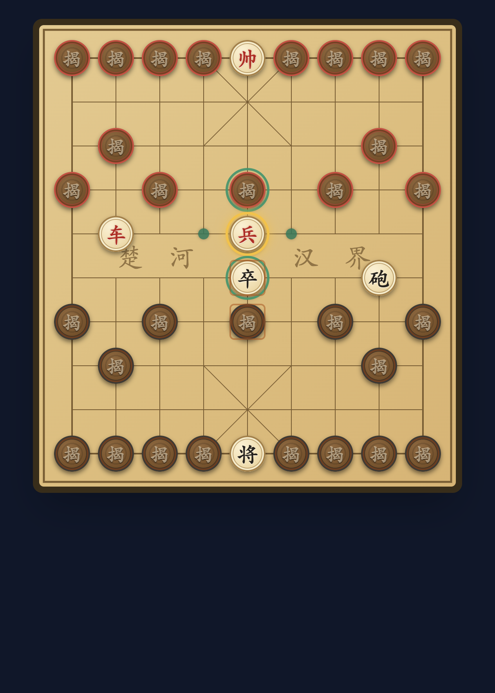
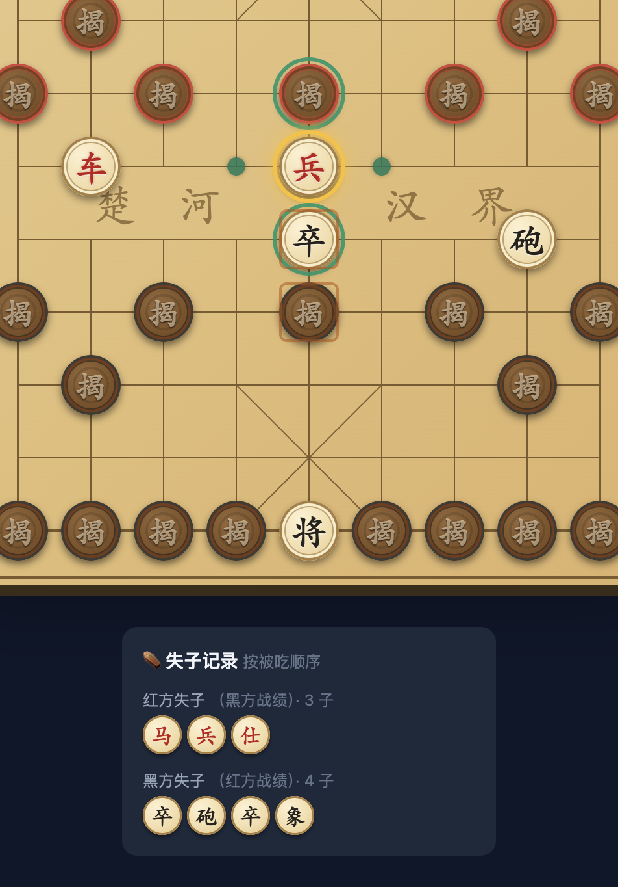
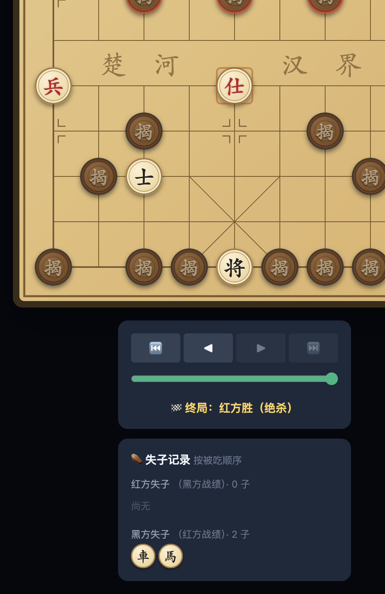

# Provably Fair Jieqi · 可验证公平的在线揭棋

**[English](README_EN.md)** | 中文

基于 Web 的双人中国象棋揭棋（Dark Chess）对战平台。核心卖点：**公平性不需要信任服务器**——密码学承诺方案 + 三方熵源 + 跨语言确定性洗牌，局后任何人在浏览器里就能独立验证整局发牌没有被操控。



<details>
<summary>更多截图：失子记录 / 复盘回放</summary>




</details>

## 与现有揭棋平台的区别

| | 本平台 | 商业平台（天天象棋揭棋等） | 其他开源揭棋 |
|---|---|---|---|
| 发牌透明度 | **全程密码学承诺，局后可独立复算** | 服务器黑箱，只能信任 | 服务器黑箱，只能信任 |
| 种子协议 | 服务端 + 双方玩家**全部 commit-reveal**，超时拒揭示判负 | 无 | 无 |
| 暗子信息安全 | 真身不出服务器，内存外挂无法读牌 | 不透明 | 通常明文下发或可抓包 |
| 验证方式 | 浏览器本地验牌器 + 完整复盘回放，无需信任客户端 | 无 | 无 |
| 技术栈 | FastAPI + React，35 项单测 + 双场景 e2e | 闭源 | 多样 |

> 据我们所知，这是**第一个把可验证公平（Provably Fair）引入揭棋的开源项目**——该机制此前主要存在于加密博彩行业，且本项目给玩家种子也加了 commit-reveal，协议严谨性比业界主流范式更进一步。

## 公平性原理（为什么可以"不信任"）

```
Step 1  Commitment      服务端生成 server_seed，开局前只公开 SHA-256(server_seed)
Step 2  Player Commit   双方各自提交 SHA-256(p_seed) 承诺（此刻谁都看不到任何种子明文）
Step 3  Player Reveal   双方承诺齐了之后才揭示 p_seed 明文，服务端校验 hash 匹配；
                        超时未揭示者直接判负（防"算输了就断线"）
Step 4  Shuffle         三方种子驱动 SHA-256 哈希链 Fisher-Yates，双方各自 15 子独立混洗
Step 5  Verification    局后公开 server_seed，任何人本地重算 hash 与洗牌并逐子比对
```

- 服务端在**看到任何玩家种子之前**就被自己的承诺锁死：局后换种子过不了 `SHA-256(server_seed) === server_seed_hash`。
- **所有种子均为 commit-reveal**：任何一方提交承诺时都无从预测最终布局，揭示时种子已全部锁死——没人能离线枚举"磨"出一个有利种子（anti-grinding）。
- 洗牌算法刻意**不用** Python `random`（梅森旋转难以跨语言复现），而是对 `f"{server_seed}:{p1}:{p2}:{i}"` 逐步取 SHA-256 前 48 bit 做 Fisher-Yates——Python 与 JavaScript 输出逐元素一致，由 `backend/tests/test_vectors.json` 中的共享向量双向钉死（pytest 与前端自检都断言同一文件）。
- 对局进行中，服务端下发的暗棋只有 `{"state":"DARK","initial_owner":...}`，**真实身份不出服务器**，内存外挂无从读起；每颗子只在合法走子翻开（或被吃）时才公布身份。

### 已知局限（诚实声明）

1. Commit-reveal 无法杜绝" abort 攻击"（算出结果不利就断线），本项目以**超时判负**（默认 60 秒，`JIEQI_REVEAL_TIMEOUT` 可调）将其转化为认输行为。
2. 48 bit 取模存在理论上的微小 modulo bias；它完全确定且可复现，不影响"可验证"目标。
3. 规则简化：无将/帅照面（飞将）裁决、无长打禁着与重复局面裁决。

## 揭棋规则要点

- 棋盘 10×9；红方帅固定明置 `(0,4)`，黑方将固定明置 `(9,4)`；**每方 15 颗暗棋只在自己半场内混洗**（红池洗入红方 15 个暗棋位，黑池洗入黑方 15 个暗棋位），翻开后颜色必然不变，只隐藏兵种。
- 暗棋只能由所属半场方操作；**首次走子必须按该初始位置的传统兵种规则**（炮位暗棋第一步按炮走，可隔子吃）。
- 完成首次合法走子后立即翻开，此后按**真实兵种**行棋——归属永远不变，你的子永远是你的子。
- 翻开后的相/象、仕/士**可过河、可出九宫**（揭棋特权）。
- **将军与应将**：王被攻击即被将军，界面会有醒目提示；被将军方必须应将——任何走完仍被将军（或主动送将）的走法都会被服务端判非法。
- **胜负**：吃掉对方帅/将、绝杀（对方被将军且无解）、困毙（对方无子可走）均判胜。

## 本地启动

```bash
# 后端（Python 3.10+）
cd backend
python -m venv .venv && source .venv/bin/activate
pip install -r requirements.txt
uvicorn app.main:app --reload --port 8000

# 前端（Node 18+），另开终端
cd frontend
npm install
npm run dev        # http://localhost:7100 ，/ws 已代理到 :8000
```

开两个浏览器窗口：一个"创建房间"，另一个输入房间号"加入"，各自提交种子后即开局。

## 测试与验证

```bash
# 单元测试（35 个：洗牌一致性/防篡改 + 全部揭棋特殊规则与将军裁决）
cd backend && pytest -q

# 端到端冒烟（双场景：commit-reveal 正常流 + 拒揭示超时判负）
JIEQI_REVEAL_TIMEOUT=3 uvicorn app.main:app --port 8000 &
python tests/e2e_smoke.py

# 跨语言一致性（JS 洗牌 vs Python 生成的共享向量）
cd frontend && node check_vectors.mjs
```

前端"验牌器"页可脱离对局独立使用：粘贴局后公开的四项数据（server_seed / hash / p1 / p2 / 30 子序列）即可纯本地验牌，也可一键跑前后端一致性自检。

## 目录结构

见 [ARCHITECTURE.md](ARCHITECTURE.md)。
