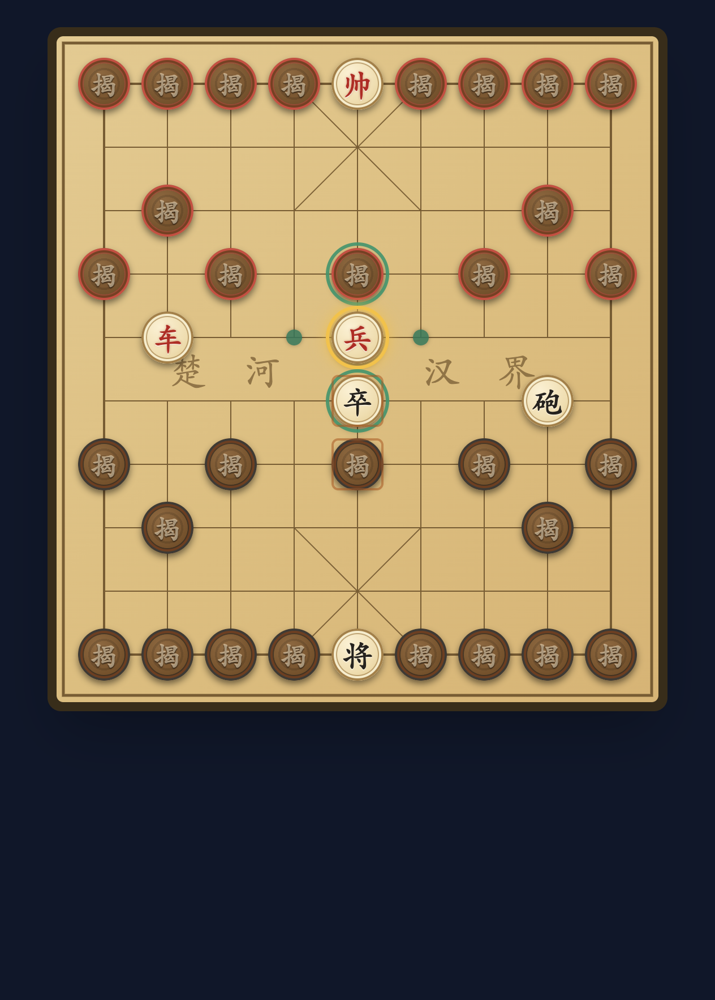
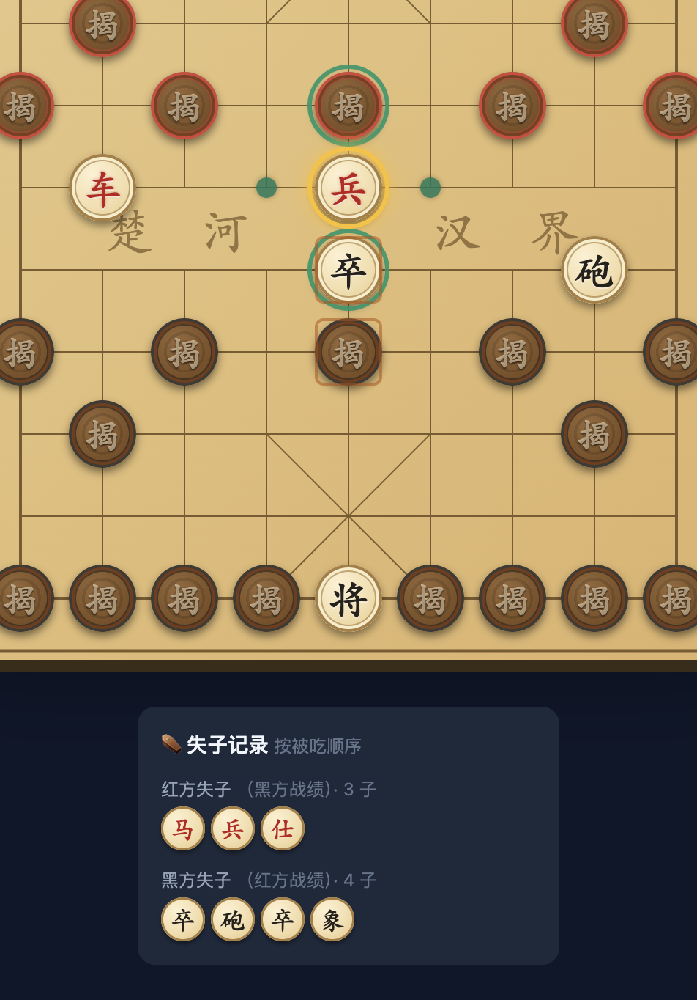
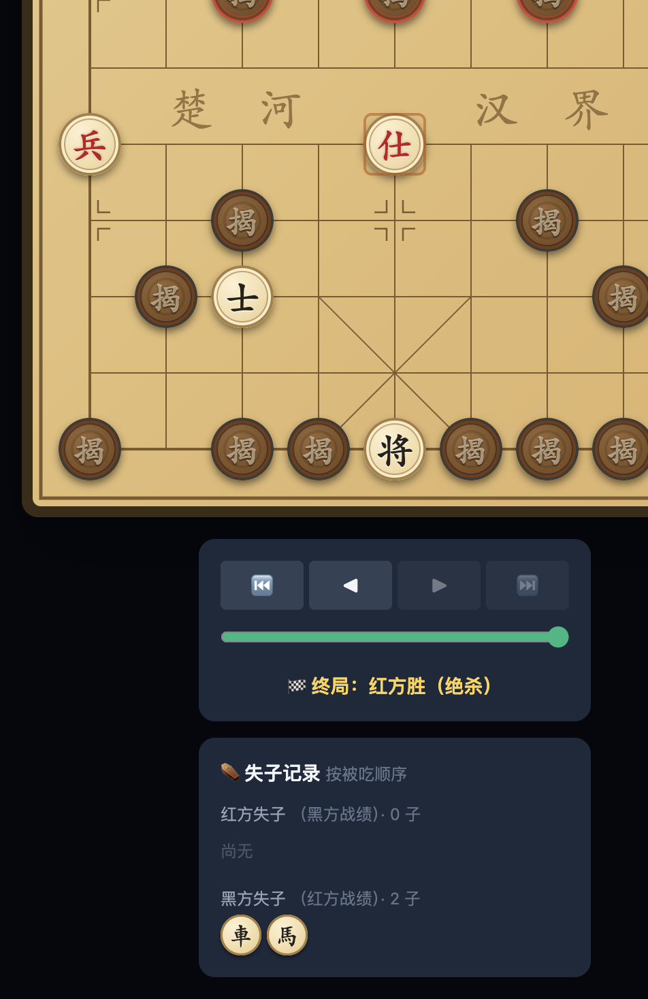

# Provably Fair Jieqi · Verifiably Fair Online Dark Chess

English | **[中文](README.md)**

A web-based two-player Jieqi (Dark Chess, a Xiangqi variant) platform. The core pitch: **fairness without trusting the server** — a cryptographic commitment scheme, three-party entropy, and a cross-language deterministic shuffle let anyone independently re-verify the entire deal in their own browser after the game.



<details>
<summary>More screenshots: captured-pieces panel / game replay</summary>




</details>

## How it differs from existing Jieqi platforms

| | This platform | Commercial platforms (e.g. Tiantian Xiangqi Jieqi) | Other open-source Jieqi |
|---|---|---|---|
| Deal transparency | **Fully committed cryptography, independently recomputable post-game** | Server black box — trust required | Server black box — trust required |
| Seed protocol | Server + both players **all commit-reveal**; refusing to reveal in time forfeits | None | None |
| Dark-piece secrecy | True identities never leave the server; memory-reading cheats get nothing | Opaque | Often sent in plaintext or sniffable |
| Verification | Browser-local verifier + full game replay, no trust in the client either | None | None |
| Tech stack | FastAPI + React, 35 unit tests + dual-scenario e2e | Closed source | Varies |

> To our knowledge, this is **the first open-source project to bring Provably Fair mechanics to Jieqi** — a mechanism previously found mainly in crypto gambling. This project goes one step further than the mainstream industry pattern by making player seeds commit-reveal as well.

## Why you don't need to trust it

```
Step 1  Commitment      Server generates server_seed, publishes only SHA-256(server_seed)
Step 2  Player Commit   Both players submit SHA-256(p_seed) (no plaintext seed is
                        visible to anyone at this point)
Step 3  Player Reveal   Once both commitments are locked, players reveal their seeds;
                        the server verifies hash match. Refusing to reveal in time
                        forfeits the game (defeats the "abort when losing" attack)
Step 4  Shuffle         Three seeds drive a SHA-256 hash-chain Fisher-Yates; each side's
                        15 dark pieces shuffle independently within their own half
Step 5  Verification    Post-game the server_seed is revealed; anyone recomputes the
                        hash and the shuffle locally, piece by piece
```

- The server is locked by its commitment **before seeing any player seed**: swapping seeds afterwards fails `SHA-256(server_seed) === server_seed_hash`.
- **Every seed is commit-reveal**: nobody can predict the final layout when committing, and all seeds are locked by reveal time — no one can grind offline for a favourable seed (anti-grinding).
- The shuffle deliberately avoids Python's `random` (Mersenne Twister is impractical to mirror in JS). Instead it takes the first 48 bits of `SHA-256(f"{server_seed}:{p1}:{p2}:{i}")` per Fisher-Yates step — Python and JavaScript produce element-identical output, pinned both ways by the shared vectors in `backend/tests/test_vectors.json` (asserted by pytest and by the frontend self-test).
- Mid-game, dark pieces are broadcast only as `{"state":"DARK","initial_owner":...}` — **true identities never leave the server**, so memory-reading cheats have nothing to read. A piece's identity is revealed only when it legally flips (or is captured).

### Known limitations (honest disclosure)

1. Commit-reveal cannot eliminate the *abort attack* (disconnecting when the outcome looks bad); this project turns it into a resignation via a **reveal timeout** (default 60s, tunable via `JIEQI_REVEAL_TIMEOUT`).
2. The 48-bit modulo has a theoretical, negligible modulo bias; it is fully deterministic and reproducible, so it does not affect verifiability.
3. Simplified adjudication: no flying-general rule, no perpetual-check/repetition rulings.

## Jieqi rules implemented

- 10×9 board; the red marshal sits face-up at `(0,4)`, the black general at `(9,4)`. **Each side's 15 dark pieces shuffle only within their own half**, so a flipped piece always keeps its colour — only its kind is hidden.
- A dark piece may only be operated by the side whose half it sits on; **its first move must follow the classical rules of the piece traditionally posted at that square** (a dark piece on a cannon square moves/captures like a cannon, screen included).
- After its first legal move the piece flips and thereafter obeys its **true kind** — ownership never changes.
- Flipped elephants/advisors **may cross the river and leave the palace** (the Jieqi privilege).
- **Check and forced resolution**: an attacked king means check, prominently displayed; any move that leaves your own king in check (or walks into one) is rejected by the server.
- **Winning**: capturing the marshal/general, checkmate, or stalemate (no legal move) all win.

## Run locally

```bash
# Backend (Python 3.10+)
cd backend
python -m venv .venv && source .venv/bin/activate
pip install -r requirements.txt
uvicorn app.main:app --reload --port 8000

# Frontend (Node 18+), in another terminal
cd frontend
npm install
npm run dev        # http://localhost:7100, /ws proxied to :8000
```

Open two browser windows: one "creates a room", the other joins with the room code; both lock and reveal their seeds, and the game begins.

## Tests & verification

```bash
# Unit tests (35: shuffle consistency/tamper-resistance + all Jieqi rules & check adjudication)
cd backend && pytest -q

# End-to-end smoke (two scenarios: normal commit-reveal flow + reveal-timeout forfeit)
JIEQI_REVEAL_TIMEOUT=3 uvicorn app.main:app --port 8000 &
python tests/e2e_smoke.py

# Cross-language consistency (JS shuffle vs. Python-generated shared vectors)
cd frontend && node check_vectors.mjs
```

The frontend "Verifier" tab works independently of any game: paste the four pieces of post-game data (server_seed / hash / p1 / p2 / the 30-piece layout) to verify locally, or run the cross-language self-test in one click.

## Directory layout

See [ARCHITECTURE.md](ARCHITECTURE.md).

## License

[MIT](LICENSE)
